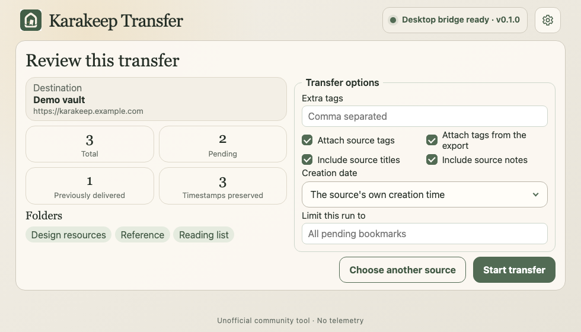
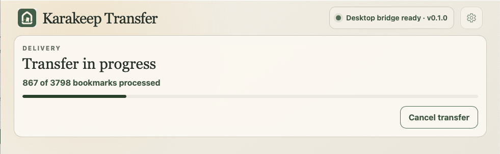
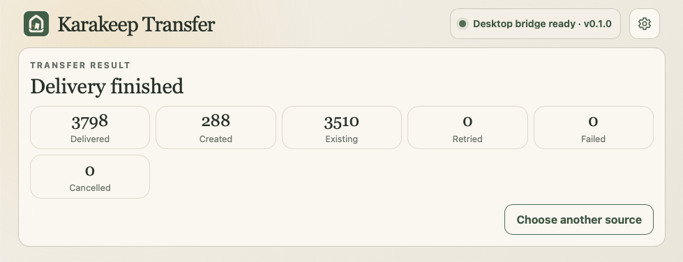
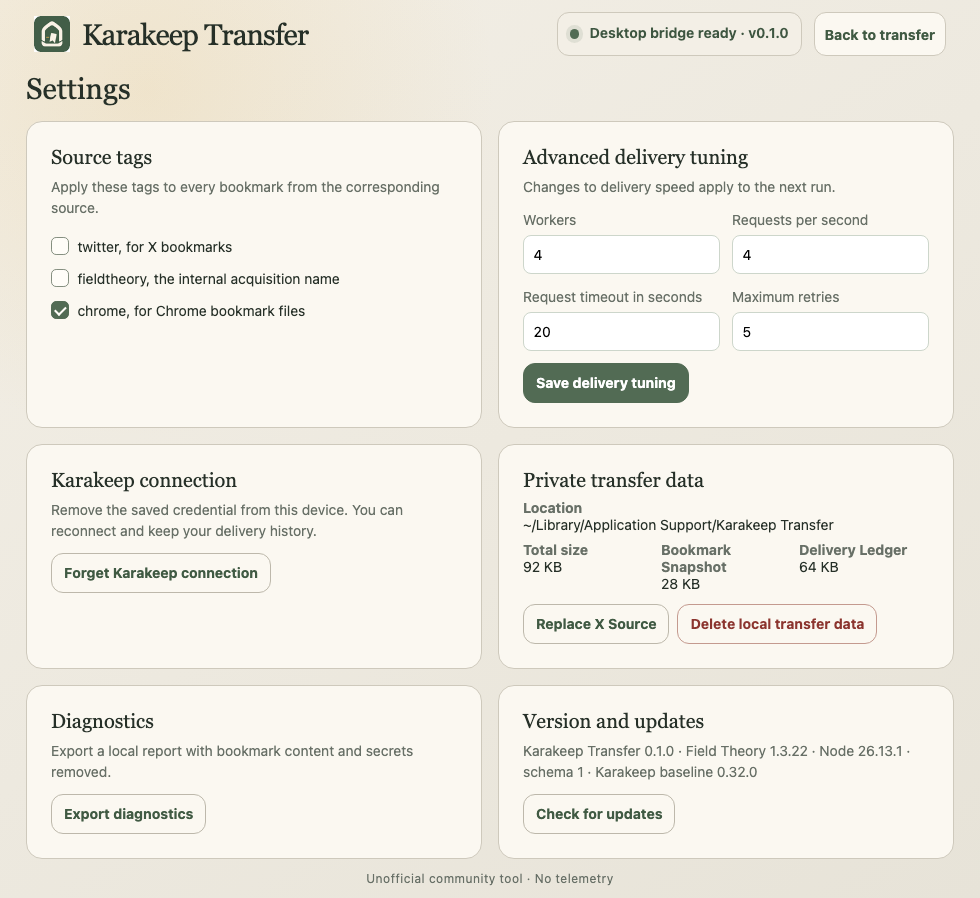

# Karakeep Transfer

Karakeep Transfer is an unofficial desktop app for transferring bookmarks to
Karakeep. Use an existing X session in a supported browser profile, or choose a
Field Theory JSONL or Chrome/Netscape bookmarks HTML export. The app keeps
transfer progress locally so you can resume an interrupted run.

## Download

**[Download v0.1.1 for macOS on Apple Silicon](https://github.com/rupertgermann/karakeep-import/releases/download/v0.1.1/Karakeep-Transfer-0.1.1-macos-arm64-unsigned.dmg)**
(unsigned test build). Requires macOS 14.8.9 or newer.

The Windows installer is pending. [Build from source](#develop-the-tauri-desktop-app)
for x86-64 PCs running Windows 10 (version 1803 or later) or Windows 11.

**Transfer review** (sample data)



## Use the app

1. In **Connect Karakeep**, enter your server address and an API key. The app
   stores the key in your operating system's credential vault.
2. For X, choose a signed-in browser profile and grant temporary access to its
   session. Select **Use this X Source**, then **Acquire X bookmarks**. For an
   export, select **Use a bookmark file** and preview the file.
3. Review the destination, pending bookmarks, and mapping options. Select
   **Start transfer**, then **Confirm transfer**.

X acquisition is best-effort. See the
[supported browser matrix](docs/platform-browser-matrix.md).

**Transfer progress**



**Transfer result**



**Settings** (sample data)



## Develop the Tauri desktop app

If you used the default clone directory, enter it before running the commands.

```bash
cd karakeep-import
```

Desktop development uses Node.js 26.13.1 LTS with
npm 11.20.0, the stable Rust toolchain, and the
[Tauri system prerequisites](https://v2.tauri.app/start/prerequisites/) for
your operating system. With nvm, run `nvm install` from the repository root
to install and select the pinned Node.js version. The repository privacy
checks use Python 3.

Install the frontend and bridge dependencies and run the automated checks.
The Rust checks need the resources directory. An empty directory is enough
for these checks.

```bash
npm ci
npm ci --prefix fieldtheory-bridge
npm test
npm run test:fieldtheory
npm run test:coverage
npm run typecheck
python3 -m unittest discover -s tests -p test_repository_privacy.py -v
mkdir -p src-tauri/resources
cargo fmt --manifest-path src-tauri/Cargo.toml -- --check
cargo check --manifest-path src-tauri/Cargo.toml
cargo clippy --manifest-path src-tauri/Cargo.toml --all-targets -- -D warnings
cargo test --manifest-path src-tauri/Cargo.toml
```

Start the native app in development mode.

```bash
npm run tauri dev
```

The Tauri development and build commands first run
`npm run prepare:fieldtheory`. It verifies the checked-in Field Theory 1.3.22
package against its SHA-256, installs its locked production dependencies, and
downloads and verifies the private Node.js 26.13.1 runtime for macOS arm64 or
Windows x64. It copies the runtime, dependencies, and license notices into the
app resources.

The accepted commit, source archive, package, Node artifacts, checksums, and
licenses are recorded in
[`vendor/fieldtheory/manifest.json`](./vendor/fieldtheory/manifest.json) and
[`vendor/fieldtheory/THIRD_PARTY_NOTICES.md`](./vendor/fieldtheory/THIRD_PARTY_NOTICES.md).
These downloads happen only while preparing a local build. The installed app
uses its private bundled runtime and never downloads or invokes a system Node
installation.

Build an unsigned desktop bundle and installer for local testing.

```bash
npm run tauri build -- --no-sign
```

On Apple Silicon macOS, the `.app` is under
`src-tauri/target/release/bundle/macos/` and the `.dmg` is under
`src-tauri/target/release/bundle/dmg/`.

For a signed release candidate, use the deterministic platform staging
procedure in
[`docs/local-release-inputs.md`](./docs/local-release-inputs.md). The staging
gate checks the pinned runtimes and dependency inventory, rejects missing
resources, runtime-download code, and secret-like values, and emits release
metadata, notices, and SHA-256 checksums.
Validate the Windows installer on a native Windows host before publishing it.

## Support development

Support the project on [Patreon](https://patreon.com/rupertgermann) or
[Buy Me a Coffee](https://buymeacoffee.com/rupertgermann).

## License

Karakeep Transfer is licensed under the [MIT License](LICENSE). Bundled
components retain their own licenses and notices.
