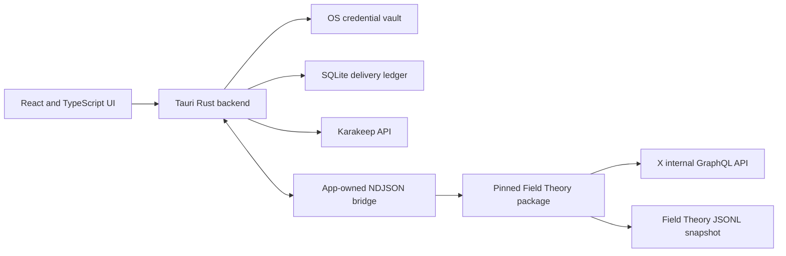

# Karakeep Transfer MVP

Status: Accepted.

Karakeep Transfer is an unofficial community desktop application for moving a
person's X bookmarks into Karakeep without requiring Python, Node.js, or command
line use.

The canonical domain language is in [`CONTEXT.md`](../CONTEXT.md). Architectural
decisions are recorded under [`docs/adr/`](./adr/).

## Product promise

A user can install the app, connect a Karakeep destination, choose a supported
browser profile already signed into X, review the bookmarks found, and start a
one-way transfer. Later transfer runs are manual, incremental, resumable, and
safe to repeat.

## Primary journey

1. Connect and validate one Karakeep destination.
2. Select one supported browser and profile as the active X source.
3. Grant explicit permission to use the existing X session temporarily.
4. Acquire X bookmark records and folder membership without downloading media.
5. Review totals, pending records, prior deliveries, folders, and destination.
6. Confirm delivery.
7. Follow structured progress and receive created, existing, retried, and
   failed totals.

Import options are split into two tiers, recorded in
[ADR 0025](./adr/0025-split-import-options-into-mapping-and-tuning.md).

- **Source mapping options** change what lands in Karakeep and appear on the
  Transfer Review screen next to the confirm action, scoped to one run: extra
  tags, suppress source default tags, suppress export-carried tags, omit titles,
  omit notes, source timestamp field, and a pending-record limit. Changing one
  re-previews the transfer and invalidates the previous approval.
- **Delivery tuning options** change throughput only and live in advanced
  Settings: worker count, requests per second, request timeout, and maximum
  retries. They persist across restarts and apply to the next run started after
  a change, never to a run already in progress.

The app owns the state path, the retry backoff shape, and the rules that compose
a title, a note, and a tag list from a source record. Those are not user-facing
controls.

## Secondary journey

**Other sources** accepts a Field Theory JSONL file or Chrome/Netscape bookmarks
HTML. A selected file is read in place for one transfer run, uses the same
preview and delivery engine, and does not replace or populate the active X
source.

## Transfer semantics

- Settings carries the set of source default tags a transfer attaches, chosen
  from `twitter`, `fieldtheory`, and `chrome`. None is selected out of the box,
  as recorded in
  [ADR 0026](./adr/0026-choose-source-default-tags-in-settings.md).
- X folder names become same-named Karakeep human tags.
- Tags are deduplicated case-insensitively.
- Empty and whitespace-only tags are discarded.
- New bookmarks preserve URL, title, tweet text, author, source timestamp,
  quoted text, and linked URLs.
- Image and video binaries are not acquired or uploaded.
- Existing Karakeep bookmarks retain their user-owned content; delivery only
  adds missing required tags.
- A bookmark is delivered only after it exists in Karakeep and every required
  tag has attached successfully.
- Partial delivery remains pending and is retried in a later run.
- No transfer deletes or replaces a Karakeep bookmark.

## Architecture

### Frontend

- React, TypeScript, and Vite.
- One explicit reducer models setup, acquisition, preview, delivery, results,
  cancellation, and recoverable failure.
- Plain CSS reuses the current visual language and favicon.
- No router, state library, component kit, utility-CSS framework, or remote
  frontend assets.

### Rust backend

- Owns Karakeep connection validation, API calls, transfer orchestration,
  payload mapping, retry and rate limiting, preview generation, cancellation,
  SQLite migrations, redacted diagnostics, and data deletion.
- Sends typed progress events to the frontend.
- Runs at most one acquisition or delivery operation at a time.
- Never passes the Karakeep API key to Field Theory.

### Field Theory bridge

- The installer contains an exact, checksum-verified upstream Field Theory
  package, its MIT license, dependencies, and a private Node runtime.
- The upstream package remains unchanged.
- An app-owned Node bridge calls the pinned acquisition modules and exposes a
  versioned NDJSON protocol for browser discovery, acquisition, progress,
  cancellation, results, and redacted errors.
- X session values never appear in bridge messages, logs, command arguments, or
  persistent storage.
- Tauri does not parse Field Theory's human terminal output.
- Field Theory and the bridge are updated only by a new signed app release.

### Persistent data

- Field Theory owns the private JSONL bookmark snapshot in the operating
  system's application-data directory.
- The app owns a migrated SQLite database for destinations, transfer runs,
  per-bookmark delivery state, retries, and redacted failures.
- Delivery history is partitioned by normalized Karakeep server identity and
  authenticated Karakeep user.
- The active X source is one browser/profile pair. **Replace X source** clears
  acquisition state and its snapshot without clearing destination delivery
  history.
- **Delete local transfer data** removes the snapshot and delivery ledger but
  not bookmarks already delivered to Karakeep.

### Credentials

- The Karakeep server URL and authenticated destination identity are ordinary
  app data.
- The API key is stored only in macOS Keychain or Windows Credential Manager.
- **Forget Karakeep connection** removes the stored credential.
- HTTPS is required by default.
- Loopback HTTP is allowed.
- Other HTTP destinations require an explicit destination-specific warning and
  exception.
- HTTPS-to-HTTP redirect downgrades are rejected.

## Compatibility boundaries

### Karakeep

- v0.32.0 is the first tested baseline.
- Compatibility is determined by the required authenticated API contract, not
  an exact version string.
- Connection setup performs only authenticated `GET` requests for the current
  user identity and one bookmark-list page.
- Granular API keys need `users:read` and `bookmarks:readwrite`; full-access
  keys also satisfy the contract.
- Karakeep v0.32 does not expose API-key scopes through a read endpoint, so
  bookmark creation and tag attachment capability are proven by the first real
  delivery. A failed write is not recorded as delivered.
- Compatible newer versions are allowed.
- Missing capabilities produce a specific unsupported-destination error.

### X

- Browser-session acquisition uses Field Theory's unofficial X GraphQL path.
- Acquisition is explicitly best-effort and may break when X changes private
  behavior.
- Existing snapshots remain available when new acquisition is unavailable.
- The UI has a dedicated compatibility failure explaining that an app update
  may be required.
- Karakeep Transfer identifies itself as unaffiliated with X, Karakeep, and
  Field Theory.

### Browsers

The tested matrix on both operating systems is:

- Google Chrome
- Microsoft Edge
- Brave
- Chromium
- Firefox

Safari and incidental Field Theory browser detections are unsupported.

## Security and privacy defaults

- No telemetry, analytics, advertising, remote logging, or crash-reporting
  service.
- Diagnostics are local, redacted, exclude bookmark content by default, and
  are exported only by explicit user action.
- The Tauri capability allowlist grants only the commands, filesystem paths,
  credential access, and sidecar execution needed by the workflow.
- The frontend uses a restrictive content-security policy and loads no remote
  code.
- Cancellation terminates active network work safely without marking partial
  records delivered.
- Log and error tests include password-equivalent X values and Karakeep keys as
  forbidden-output canaries.

## UI states

The single-window flow covers:

- first-run welcome and unofficial-product disclosure;
- Karakeep connection setup and validation;
- browser detection, profile choice, and X-session consent;
- acquisition progress and cancellation;
- transfer preview, source mapping options, and confirmation;
- delivery progress and cancellation;
- completed, partial, interrupted, authentication, compatibility, and network
  failure results;
- settings for connection replacement, source replacement, data deletion,
  source default tags, advanced delivery tuning, local diagnostics, version
  information, and manual update checking;
- **Other sources** for one-off file imports.

## Platform and release

- Product name: **Karakeep Transfer**.
- Default application identifier:
  `io.github.rupertgermann.karakeeptransfer`.
- macOS 14.8.9 or newer, Apple Silicon DMG.
- Windows 10 version 1803 or newer and Windows 11, x86-64 NSIS installer.
- Native Windows ARM64, Linux packages, and app stores are outside the MVP.
- All public macOS artifacts are Developer ID signed and notarized.
- All public Windows executables and installers are Authenticode signed.
- Builds, tests, signing, packaging, checksums, notices, and release metadata
  are produced locally. GitHub Actions is not used.
- Signed artifacts, SHA-256 checksums, and third-party notices are uploaded
  manually to GitHub Releases.
- The MVP has a user-triggered **Check for updates** link but no automatic
  download or installation.

## Existing command-line tools

- `karakeep-import.py` remains available and supported during the MVP
  migration, but is not bundled in the desktop installer.
- It supplies black-box parity fixtures for the Rust delivery engine.
- `karakeep-import-gui.py` is removed only after the packaged Tauri workflow
  passes parity and acceptance checks.
- Existing GUI visual and favicon work must be migrated rather than
  overwritten.

## Out of scope

- Background or scheduled transfer
- Two-way synchronization
- Multiple simultaneous X sources or Karakeep destinations
- OAuth or manual X-cookie entry
- X media archiving
- Karakeep content overwrites or deletions
- Delivery ledger and snapshot path selection
- Retry backoff shape and payload structure controls
- The superseded script options `--state-file`, `--failure-file`,
  `--progress-every`, `--api-key-env`, and `--execute`
- Automatic app updates
- Remote telemetry and crash reporting
- Linux, native Windows ARM64, and store distribution

## Implementation sequence

Repository work must follow the mandatory TDD2 red-green constraint gauntlet.
Each phase starts with executable acceptance or contract tests.

### 1. Lock behavioral contracts

- Preserve the existing GUI and favicon work.
- Add golden Field Theory and Chrome inputs.
- Capture Python importer outcomes against a fake Karakeep server.
- Define secret-redaction, duplicate, tag, timestamp, retry, cancellation, and
  partial-delivery cases.

### 2. Scaffold the native core

- Create the Tauri 2, React, TypeScript, and Rust workspace.
- Add the versioned SQLite schema and migrations.
- Implement the Karakeep API client and OS credential-vault boundary.
- Port delivery behavior test-first until parity fixtures pass.

### 3. Integrate Field Theory

- Pin and verify the upstream package and private Node runtime.
- Implement the NDJSON bridge and Rust sidecar supervisor.
- Add browser/profile discovery, `FT_DATA_DIR` isolation, acquisition without
  media, folder acquisition, structured progress, cancellation, and
  compatibility errors.
- Contract-test the bridge without using a real browser session; reserve real
  account access for explicit local smoke tests.

### 4. Build the guided frontend

- Port the current styling and favicon into React components.
- Implement setup, source consent, acquisition, preview, confirmation,
  delivery, results, settings, diagnostics, and file-source flows.
- Add component and reducer tests for every state transition.

### 5. Cross-platform acceptance

- Verify clean macOS and Windows installations require neither Python nor
  system Node.
- Test every supported browser/profile path on both platforms.
- Test fresh, repeated, interrupted, partially tagged, changed-destination,
  replaced-source, insecure-HTTP exception, and local-data deletion scenarios.
- Inspect packaged artifacts for forbidden secrets, missing licenses, and
  undeclared runtime downloads.

### 6. Local release

- Build and sign in controlled local macOS and Windows environments.
- Notarize the macOS artifact.
- Generate checksums, dependency notices, versions, and release metadata.
- Install and smoke-test the final artifacts before manually publishing them
  to GitHub Releases.

## MVP acceptance

The MVP is complete only when:

- a clean macOS or Windows user can acquire and transfer X bookmarks without a
  terminal or separately installed runtime;
- a repeat run does not overwrite existing Karakeep content and correctly
  skips or finishes prior deliveries;
- source and folder tags are complete before delivery is recorded;
- cancellation and restart preserve safe state;
- changing source and destination obeys their separate state boundaries;
- file sources use the same delivery guarantees;
- no X session or Karakeep API key appears in frontend state, process
  arguments, SQLite, JSONL metadata, logs, diagnostics, or test artifacts;
- locally built signed installers pass platform smoke tests;
- bundled Field Theory, Node, and other third-party components have pinned
  versions, checksums, and license notices.
