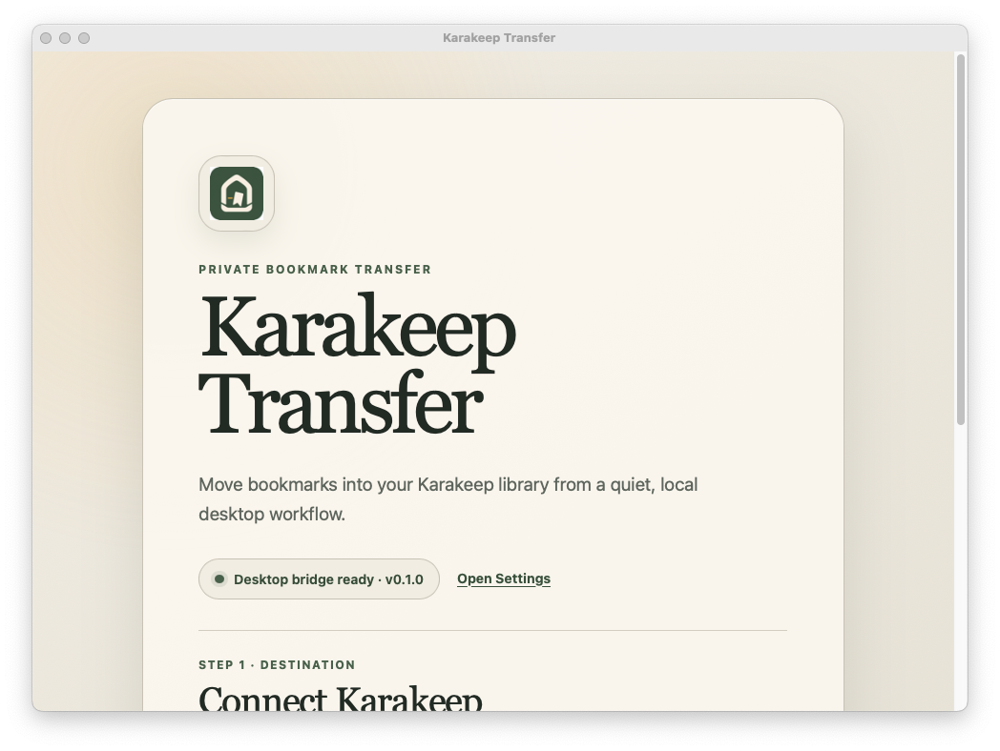

# macOS universal preflight

This document retains the unsigned local preflight evidence for GitHub issue
#16. It does not claim that the signed macOS release candidate is accepted.
Developer ID signing, notarization, native Intel testing, controlled transfers,
and the complete supported-browser matrix remain release gates.

## Tested source and host

- Implementation commit: `d9cc4ee80956f9826cf70ab0e5578bbeb2ba9365`
- Branch: `feat/karakeep-transfer-mvp`
- Host: macOS 14.8.7 on Apple Silicon
- Rust: 1.93.0
- Node.js: 24.18.0 for the local build
- Bundled private Node.js: 22.20.0
- Bundled Field Theory: 1.3.22

The build used only local inputs and the target-specific command generated in
`release-inputs/macos-universal/NATIVE-BUILD-COMMAND.txt`:

```bash
npm run tauri -- build --target universal-apple-darwin --bundles dmg
```

Tauri built both Rust target binaries and combined them with `lipo`. The
filesystem sandbox prevented `hdiutil create`; running the unchanged generated
DMG script in the controlled local macOS environment completed successfully.

## Retained results

| Gate | Status | Evidence |
| --- | --- | --- |
| Universal application executable | PASS | `lipo -archs` returned `x86_64 arm64`. |
| Declared macOS baseline | PASS | Both Mach-O slices report `minos 12.0`. |
| Universal DMG integrity | PASS | `hdiutil verify` reported a valid disk image. |
| DMG installation layout | PASS | A read-only mount contained `Karakeep Transfer.app` and the `/Applications` link. |
| Isolated application launch | PASS | LaunchServices accepted and opened the final local app bundle. |
| Guided first screen | PASS | The retained packaged visual preflight and final UI tests show the ready desktop bridge and Step 1, **Connect Karakeep**, rather than stopping at an intro-only screen. |
| Private runtime packaging | PASS | The app contains arm64 and x86-64 Node executables, Field Theory, its bridge, checksums, licenses, and notices. |
| No separately installed Node requirement | PASS | With `PATH=/nonexistent` and an empty home directory, the packaged arm64 Node executable started the packaged bridge and returned a protocol-v1 browser discovery result. |
| Browser/profile discovery | PASS | The packaged bridge discovered three installed supported browsers and seven profiles; names and paths were not retained. |
| Intel runtime execution on this host | PASS | `arch -x86_64` ran the final packaged x86-64 Node runtime under Rosetta and reported version 22.20.0. This is not native Intel-host evidence. |
| Developer ID signature | FAIL | `codesign` reported an ad-hoc linker signature, no Team Identifier, and no sealed resources. The local keychain contains no valid code-signing identity. |
| Gatekeeper execution assessment | FAIL | `spctl` did not accept the unsigned app. |
| Apple notarization and stapling | UNAVAILABLE | Notarization cannot proceed without a Developer ID identity and notarization credentials. |
| Native Intel clean installation | UNAVAILABLE | No controlled Intel Mac is available in this environment. |
| Five-browser acquisition matrix | UNAVAILABLE | Real session acquisition still requires explicit local consent and retained evidence for Chrome, Edge, Brave, Chromium, and Firefox. |
| Controlled X transfer | UNAVAILABLE | No explicitly approved X session and controlled Karakeep destination were provided for this preflight. |
| Controlled File Source transfer | UNAVAILABLE | No controlled Karakeep destination was provided for this preflight. |

The unsigned DMG SHA-256 was:

```text
3ed13b525a7d31411f366941a52b5601f8fc7599dd9b5632a3c5a354ad5d082e
```

That checksum identifies only this unsigned development artifact. It must not
be published or reused as the checksum for the signed and notarized release
candidate.

## Packaged first screen



## Remaining issue #16 gates

1. Install a valid Developer ID Application identity in the controlled release
   keychain.
2. Rebuild and sign the universal app and DMG from the accepted source commit.
3. Submit the DMG for notarization, staple the ticket, and pass `codesign`,
   `spctl`, `stapler validate`, and `hdiutil verify`.
4. Run the clean-install and supported-browser matrix on Apple Silicon and
   Intel Macs.
5. Complete primary X and secondary File Source transfers against a controlled
   Karakeep destination and retain redacted evidence.
